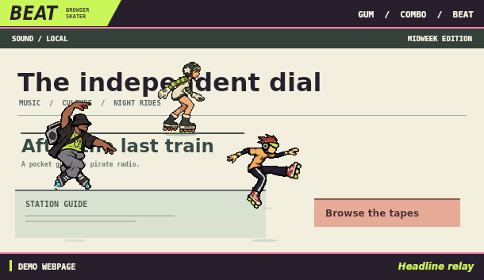

# Beat — Remix sprites and street art

**Remix** gives Beat 36 cels on a six-column transparent sheet. Each of the nine actions uses four frames. The pivot sits at the skates, at (64, 116) inside a 128 × 128 cell. The frame map includes tight bounds for every cel and the action playback order.

| Sheet | Artwork | Frame map |
|---|---|---|
| Remix Beat | [Download PNG](remix/sheet.png) | [Animations and bounds](remix/frames.json) |
| Street marks | [Download PNG](street/sheet.png) | [Sticker indexes](street/frames.json) |

The street sheet contains **Static Wax** (lightning on vinyl), **Alleycat** (a pink mohawk), **Spool Skull** (a cassette skull), and the spray-can pickup. Beat paints the three tags one at a time.

These are new, generated fan-art assets in visual review. Beat and Jet Set Radio belong to SEGA. The script also includes a Classic option with the original xugggys sheet.

[Play with Beat in Universal Userscripts](https://github.com/slllky/universal-userscripts/tree/main/companions/beat)
