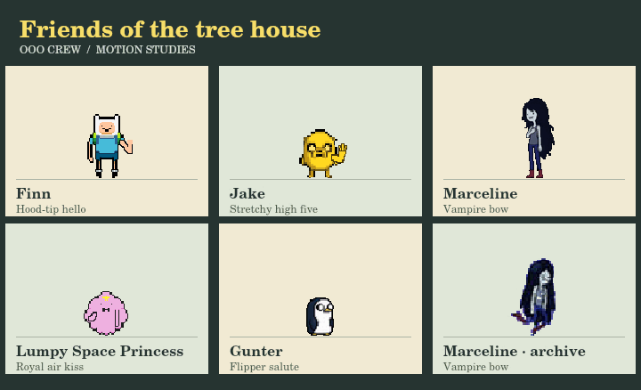
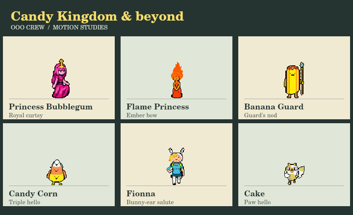
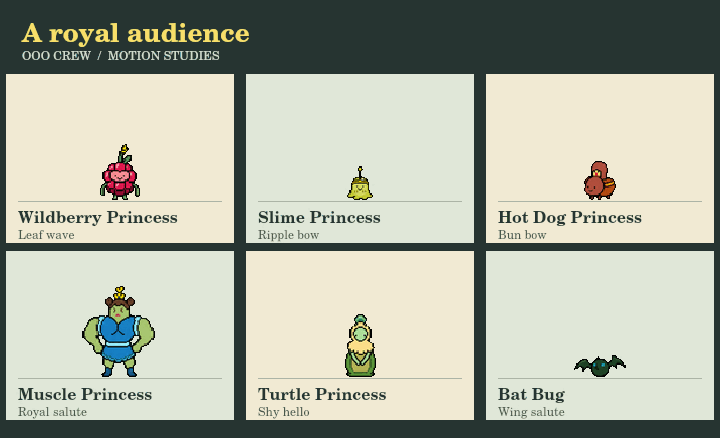

# Ooo Crew action sheets

Each returning companion gets two additional actions in Ooo Crew 1.2.0. The first row of each transparent sheet is the greeting and the second row is the signature flourish. Each row has three drawings. These sheets are available to try in the userscript while awaiting visual approval.

| Companion and PNG | Greeting | Flourish | Coordinates |
|---|---|---|---|
| [Finn](finn/sheet.png) | Hood-tip hello | Unroll quest map | [Frame map](finn/frames.json) |
| [Jake](jake/sheet.png) | Stretchy high five | Pancake flip | [Frame map](jake/frames.json) |
| [Marceline](marceline/sheet.png) | Vampire bow | Bass slide | [Frame map](marceline/frames.json) |
| [Marceline (archive outfit)](archive/sheet.png) | Vampire bow | Bass slide | [Frame map](archive/frames.json) |
| [Lumpy Space Princess](lsp/sheet.png) | Royal air kiss | Royal fan flourish | [Frame map](lsp/frames.json) |
| [Gunter](gunter/sheet.png) | Flipper salute | Bottle juggle | [Frame map](gunter/frames.json) |
| [Princess Bubblegum](bubblegum/sheet.png) | Royal curtsy | Sample swirl | [Frame map](bubblegum/frames.json) |
| [Flame Princess](flame/sheet.png) | Ember bow | Kindle a spark | [Frame map](flame/frames.json) |
| [Banana Guard](banana/sheet.png) | Guard’s nod | Staff drill | [Frame map](banana/frames.json) |
| [Candy Corn](corn/sheet.png) | Triple hello | Candy wobble | [Frame map](corn/frames.json) |
| [Fionna](fionna/sheet.png) | Bunny-ear salute | Trail map | [Frame map](fionna/frames.json) |
| [Cake](cake/sheet.png) | Paw hello | Tail heart | [Frame map](cake/frames.json) |
| [Wildberry Princess](wildberry/sheet.png) | Leaf wave | Berry bouquet | [Frame map](wildberry/frames.json) |
| [Slime Princess](slime/sheet.png) | Ripple bow | Bubble crown | [Frame map](slime/frames.json) |
| [Hot Dog Princess](hotdog/sheet.png) | Bun bow | Mustard twirl | [Frame map](hotdog/frames.json) |
| [Muscle Princess](muscle/sheet.png) | Royal salute | Double biceps | [Frame map](muscle/frames.json) |
| [Turtle Princess](turtle/sheet.png) | Shy hello | Bookmark reveal | [Frame map](turtle/frames.json) |
| [Bat Bug](batbug/sheet.png) | Wing salute | Echo pulse | [Frame map](batbug/frames.json) |

The art combines generated character poses with newly animated pixel edits of the existing cast. All character designs belong to their respective rights holders. [Original sprite credits](https://github.com/slllky/universal-userscripts/blob/main/companions/ooo-crew/assets/README.md).
