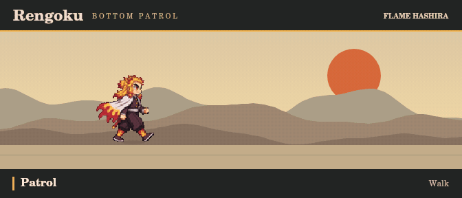

# Rengoku · Bottom Patrol

Art in use in Bottom Patrol 2.0.0, available here for visual review. Download a transparent PNG to view the full sheet. The frame maps include the pose order, native direction and opaque bounds for each cell.

| Character | Motion | Art |
|---|---|---|
| Rengoku | Idle, walk, run, vault, brace, three flame techniques and a victory salute | [Sheet](rengoku/sheet.png) · [Frame map](rengoku/frames.json) |
| Pink Demon | Pinky’s charge and ember disappearance | [Sheet](pink/sheet.png) · [Frame map](pink/frames.json) |
| Lantern Eye | A floating, swooping eye | [Sheet](pack2/sheet.png) · [Frame map](pack2/frames.json) |
| Furnace Brute | A heavy stomp | [Sheet](pack3/sheet.png) · [Frame map](pack3/frames.json) |
| Dusk Stalker | A fast pounce | [Sheet](pack4/sheet.png) · [Frame map](pack4/frames.json) |
| Silk Moth | Silk-thread dive | [Sheet](moth/sheet.png) · [Frame map](moth/frames.json) |
| Temple Bell | Brass-ring pulse | [Sheet](bell/sheet.png) · [Frame map](bell/frames.json) |
| Foxfire | Blue-flame feint | [Sheet](foxfire/sheet.png) · [Frame map](foxfire/frames.json) |
| Basalt Oni | Cinder stomp | [Sheet](oni/sheet.png) · [Frame map](oni/frames.json) |

Each demon has idle, movement, attack, recoil, and defeat frames. See [Bottom Patrol’s art credits](https://github.com/slllky/universal-userscripts/blob/main/companions/rengoku/assets/README.md).
